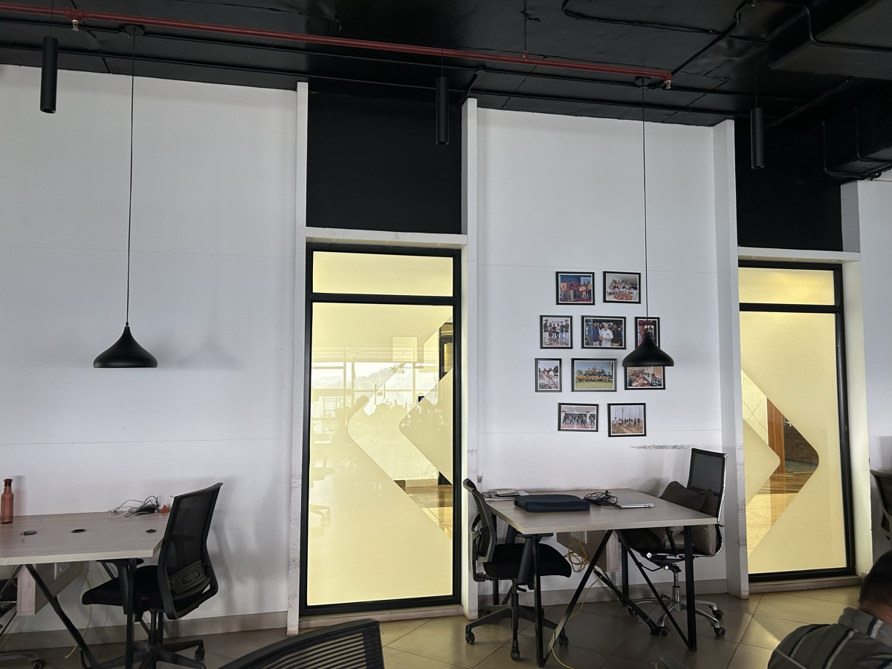
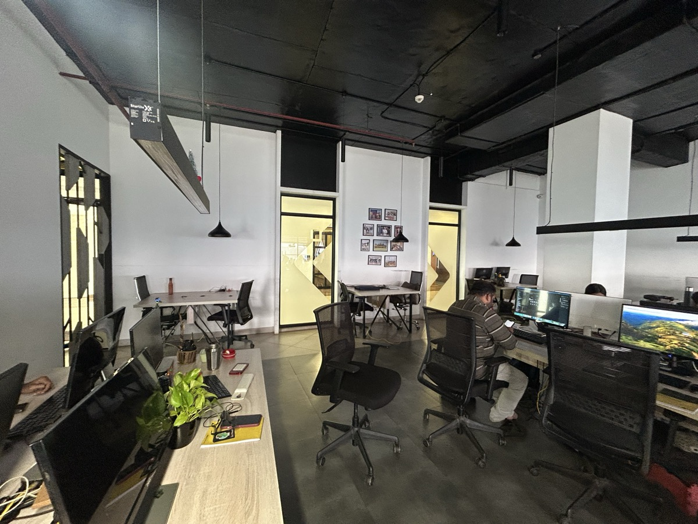

# Suggestion 2: make this look like the image

- **Status:** done
- **Section:** East wall · Workspace
- **Point:** x 9.95, y 1.58, z 13.26 m (x from the window wall, z from the corner-cabin end; see floorplan/floorplan_proposed.png)
- **Created:** 2026-11-19 10:34 · **Updated:** 2026-11-19 10:44

## What needs to change

make this look like the image

## Attachments

- 
- 
- 
- 

## Claude's notes

East wall now matches the photos: two amber frosted doors with the white diamond graphic in white bays (pilasters + black panel above), a framed photo grid above desk E2, and black cone pendants over the three wall desks. (src/world/workspace.js: doorBay, photoGrid)
