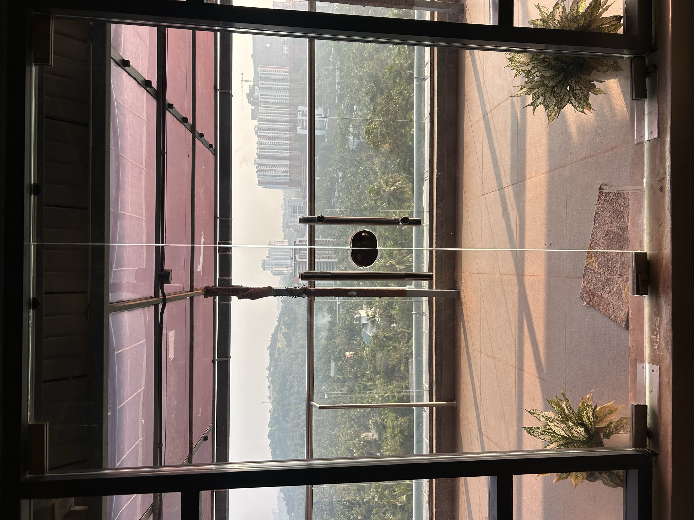

# Suggestion 10: add a door to outside , like when i press f open this door to inside like two do

- **Status:** done
- **Section:** Window Lounge
- **Point:** x 0.05, y 1.23, z 5.66 m (x from the window wall, z from the corner-cabin end; see floorplan/floorplan_proposed.png)
- **Created:** 2026-11-19 10:49 · **Updated:** 2026-11-19 10:51

## What needs to change

add a door to outside , like when i press f open this door to inside like two door system

## Attachments

- 
- 

## Claude's notes

Added a frameless glass double door in the lounge window wall, onto the terrace, like your photo: long chrome pull handles, a fixed glass panel above, a doormat and a plant on each side outside. Stand near it and press F: both leaves swing inward; press F again to close. With it open you can walk out onto the terrace (the railing stops you). Code: src/doors.js.
