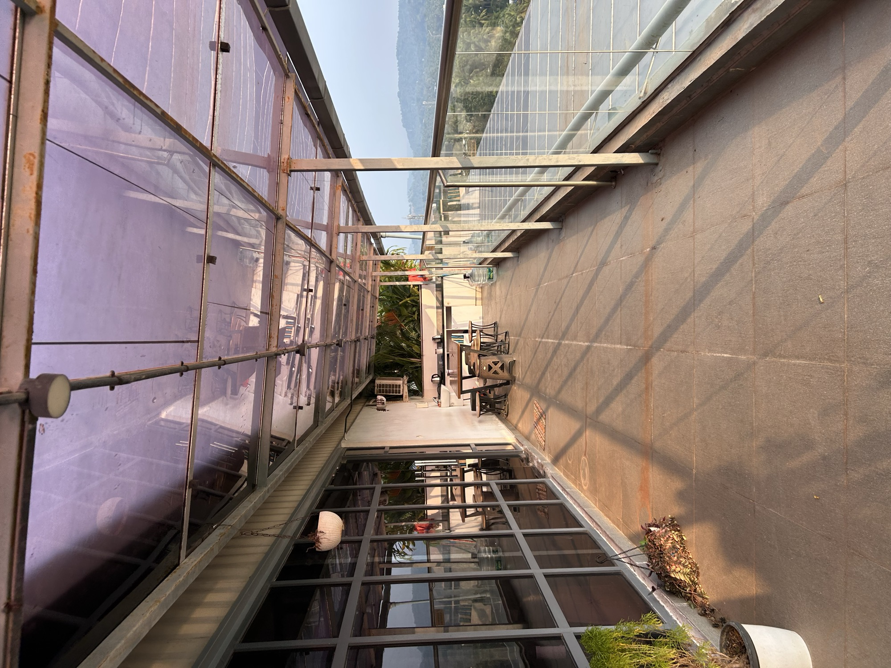
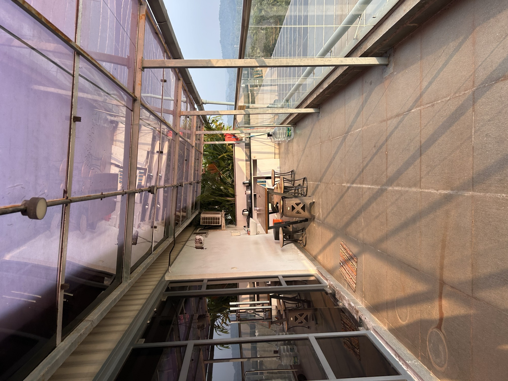
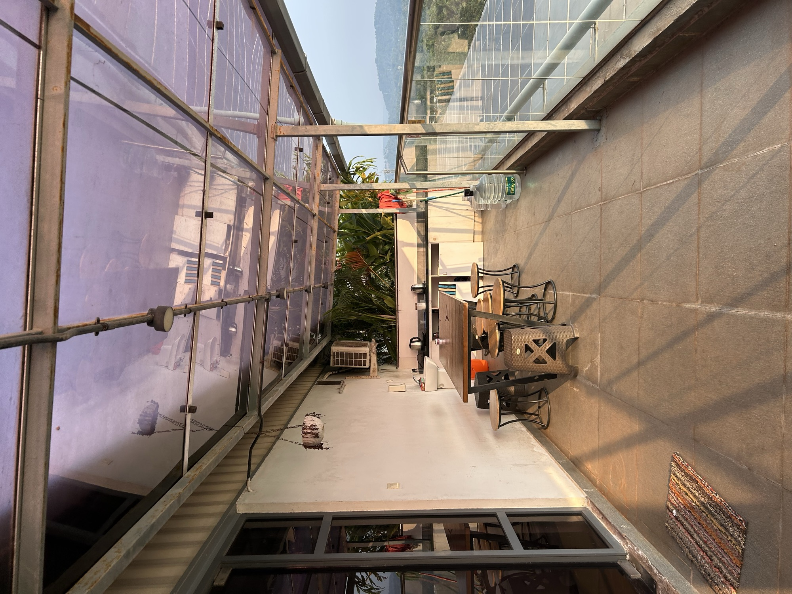
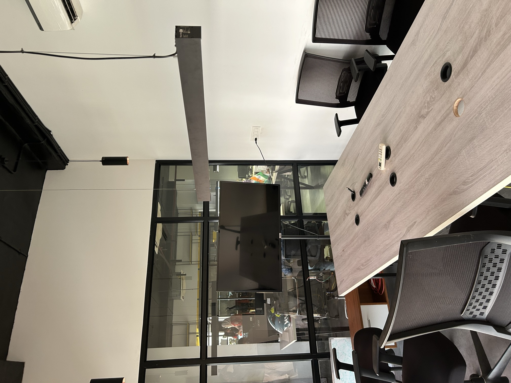
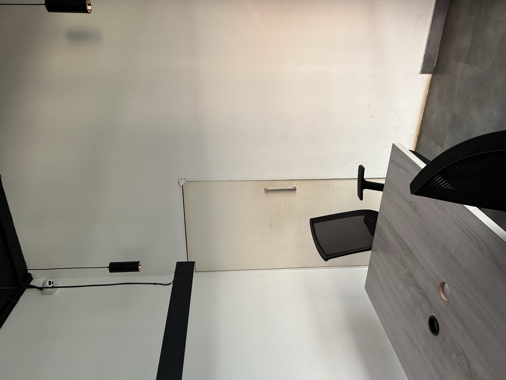
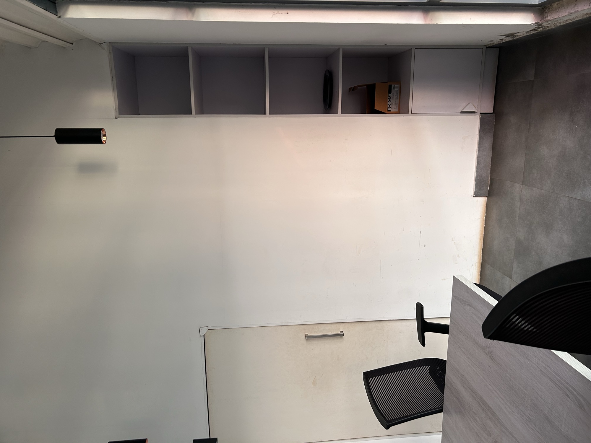

# Suggestion 13: need to extend more like in right side there is a meeing room and also include t

- **Status:** done
- **Section:** Terrace · Terrace
- **Point:** x -1.71, y 1.18, z 18.70 m (x from the window wall, z from the corner-cabin end; see floorplan/floorplan_proposed.png)
- **Created:** 2026-11-19 12:02 · **Updated:** 2026-11-19 12:02

## What needs to change

need to extend more like in right side there is a meeing room and also include the table and char to extend , and add meeint room in right side and also after meeting room it also need some space so extend almost a bit more like use this images and add meeting room with the inside image , and from the office view i add that

## Attachments

- 
- 
- 
- 
- 
- 
- 
- 
- 
- 
- 
- 

## Claude's notes

Extended the terrace past the workspace back wall to z 25.2 m and added a meeting room on the window side (x 0–3.7, z 18.7–22.6) from your photos: white walls, exposed black ceiling, a long grey-oak table with 7 mesh chairs, a TV on a rolling stand in front of the glass window to the workspace, a grey linear light plus black cylinder pendants, a split AC, a white flush door and a tall white shelf in the window corner, and a low wooden cabinet under the window. From the terrace there is a glass double door into it, the same as the lounge balcony door (press F to open). After the meeting room the facade is white plaster with the wash basin and outdoor AC, and the pantry (counter, table, stools, water cans, palms) moved to the new far end. Code: src/world/meeting.js, src/world/terrace.js, src/doors.js.
