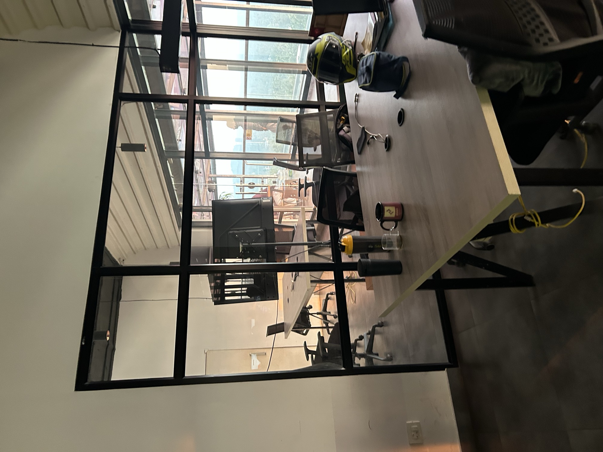

# Suggestion 14: i added a suggestion 13 and so that the view look like this in the image

- **Status:** done
- **Section:** Back wall · Workspace
- **Point:** x 1.41, y 1.62, z 18.60 m (x from the window wall, z from the corner-cabin end; see floorplan/floorplan_proposed.png)
- **Created:** 2026-11-19 12:02 · **Updated:** 2026-11-19 12:02

## What needs to change

i added a suggestion 13 and so that the view look like this in the image

## Attachments

- 
- 

## Claude's notes

The workspace back wall now has a black-framed glass window (3×3 panes, about 2.5 m wide, near the windows) looking into the new meeting room, so from your saved view you see the TV, the table and chairs, and the terrace beyond, like IMG_5673. Code: src/world/workspace.js.
