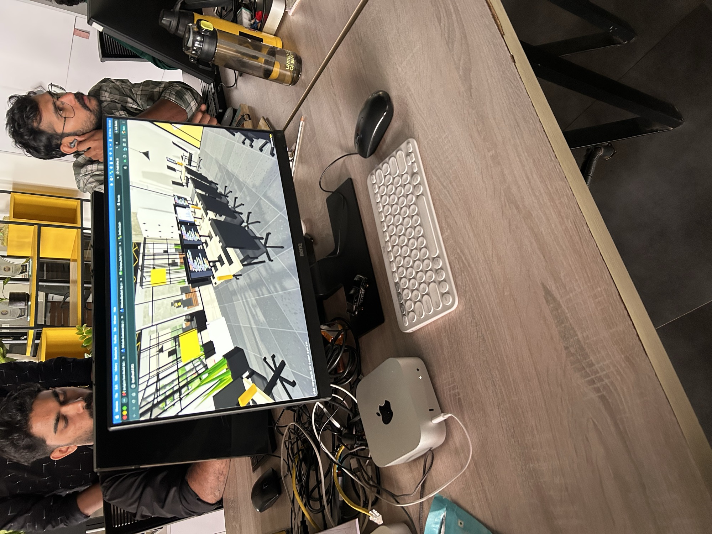

# Suggestion 21: make table like this monitor , and mac keybord with this details

- **Status:** done
- **Section:** Monitor · Desk · Long table L1 · Workspace
- **Point:** x 4.57, y 0.78, z 10.99 m (x from the window wall, z from the corner-cabin end; see floorplan/floorplan_proposed.png)
- **Created:** 2026-11-20 05:23 · **Updated:** 2026-11-20 05:23

## What needs to change

make table like this monitor , and mac keybord with this details

## Attachments

- 
- 

## Claude's notes

Long-table desks now match the photo: grey-oak top with a pale edge band and black crossed (X) legs; each seat has a thin-bezel monitor on a wide flat stand, a silver Mac mini, a compact white round-key keyboard and a black mouse.
