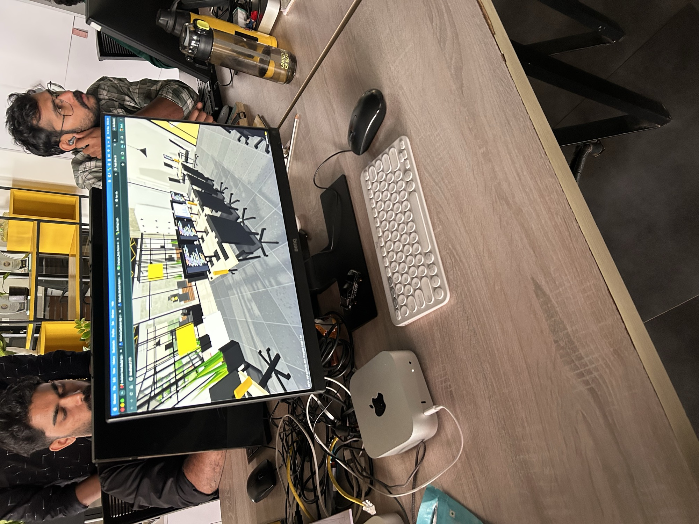

# Suggestion 22: this mac and waterbottile little outside the desk fix that and reduce monition l

- **Status:** done
- **Section:** Monitor · Desk · Long table L1 · Workspace
- **Point:** x 3.52, y 0.81, z 11.11 m (x from the window wall, z from the corner-cabin end; see floorplan/floorplan_proposed.png)
- **Created:** 2026-11-20 05:25 · **Updated:** 2026-11-20 05:25

## What needs to change

this mac and waterbottile little outside the desk fix that and reduce monition like match the monitor in this image

## Attachments

- 
- 

## Claude's notes

Resized each workstation to fit its 0.7 m seat: monitor now 0.54 m wide (24-inch like the photo), Mac mini smaller and moved onto the desk, bottle moved in, keyboard and mouse tightened. Nothing overhangs the desk edge now.
