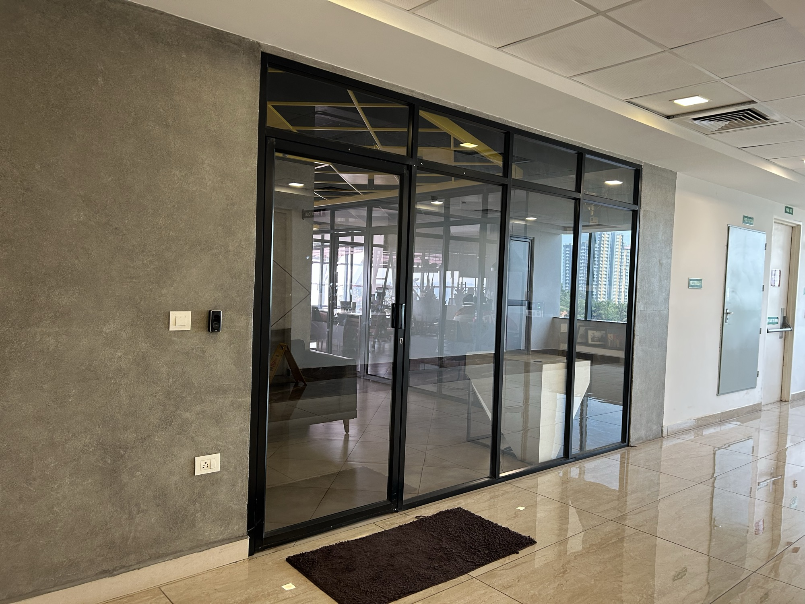

# Suggestion 23: make this look like this , like make more details

- **Status:** done
- **Section:** Building Hall
- **Point:** x 10.30, y 1.36, z 7.83 m (x from the window wall, z from the corner-cabin end; see floorplan/floorplan_proposed.png)
- **Created:** 2026-11-20 06:25 · **Updated:** 2026-11-20 06:42

## What needs to change

make this look like this , like make more details

## Attachments

- 
- 

## Claude's notes

Rebuilt the entrance as seen from the hall (photo IMG_5704): concrete wall beside the glass front with light switch, fingerprint reader and socket, brown doormat outside, black-framed glass with the openable door (F), concrete pillar, then the white wall with the grey fire-hose cabinet, fire exit door with push bar and green signs. Ceiling now has 600 mm grid tiles, lowered side bulkheads with cove light, AC diffusers, downlights, smoke detectors and CCTV. New file src/world/hall.js.
