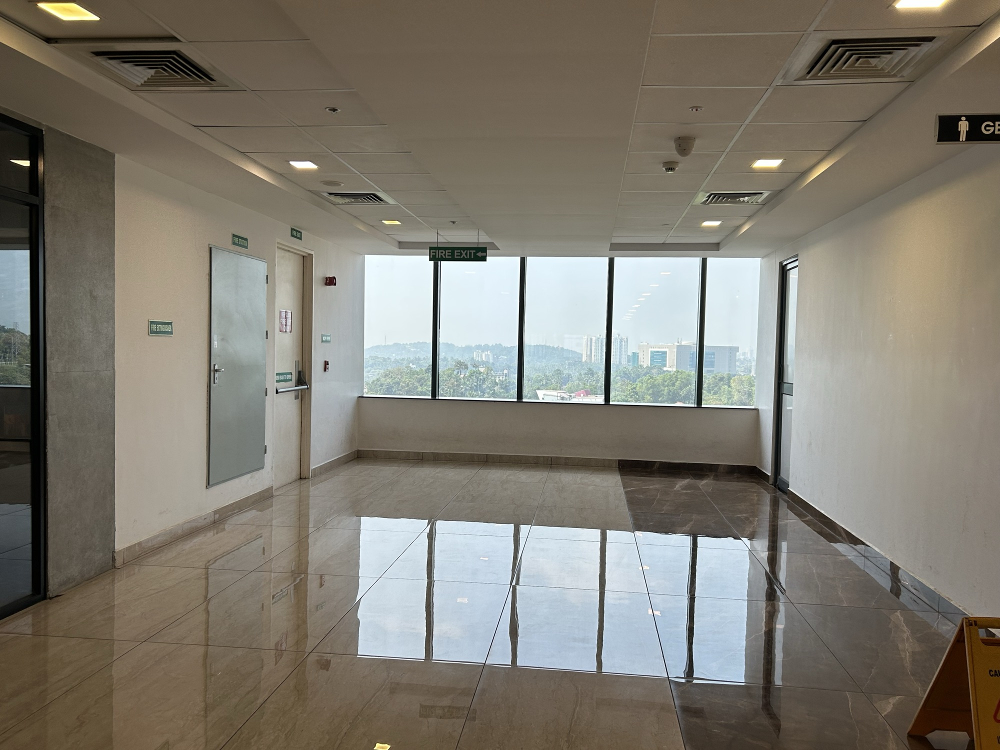

# Suggestion 24: make it look like this

- **Status:** done
- **Section:** Wall (Building Hall) · Building Hall
- **Point:** x 13.36, y 0.83, z 0.10 m (x from the window wall, z from the corner-cabin end; see floorplan/floorplan_proposed.png)
- **Created:** 2026-11-20 06:43 · **Updated:** 2026-11-20 06:43

## What needs to change

make it look like this

## Attachments

- 
- 

## Claude's notes

The hall's north end now matches IMG_5705 (with IMG_5706/5707 for the rest): low sill + 5-pane window onto the hills, hanging FIRE EXIT sign, glossy beige marble with a brown marble band along the east side, glass door by the window, Gents toilet (laminate door with vision slot, blade sign, orange fire ball, yellow caution board), the neighbour office (black glass double door, diamond-pattern wall with sign between wood strips, track spots) and the pixbit sign + frosted panel on the concrete wall. The hall is now 4.6 m wide and runs to a second window at the far end.
