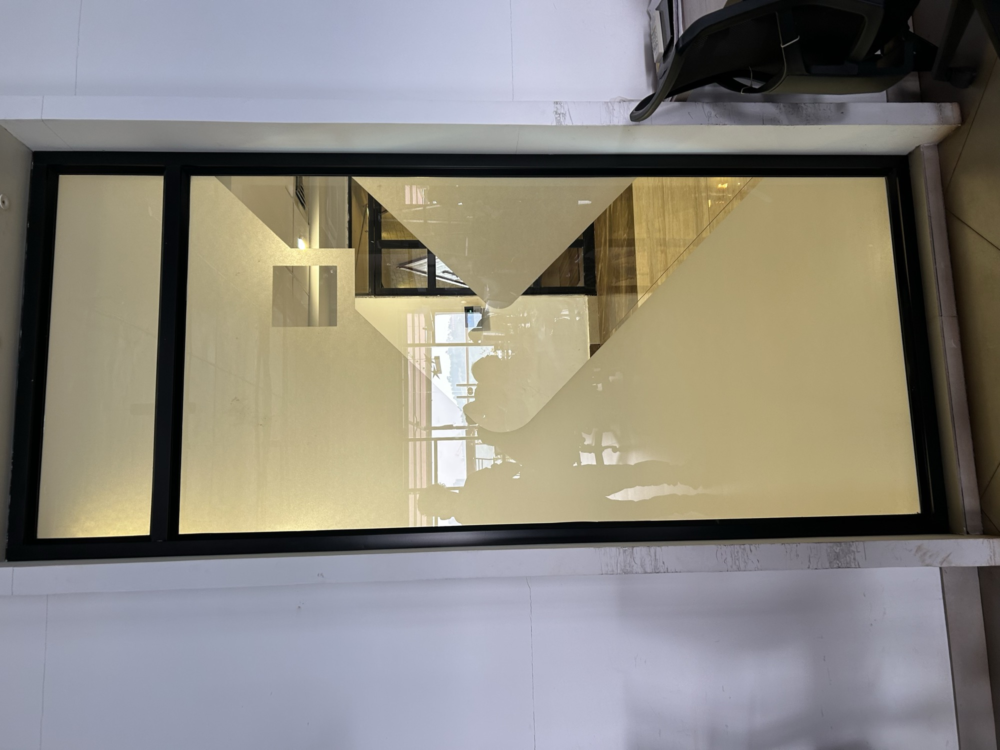

# Suggestion 25: make this like this , like transperent , also from other side see

- **Status:** done
- **Section:** Door · Workspace
- **Point:** x 9.81, y 1.27, z 12.85 m (x from the window wall, z from the corner-cabin end; see floorplan/floorplan_proposed.png)
- **Created:** 2026-11-20 06:52 · **Updated:** 2026-11-20 06:52

## What needs to change

make this like this , like transperent , also from other side see

## Attachments

- 
- 

## Claude's notes

The amber door at z 12.45 is now real see-through glass (photo IMG_5731): amber-tinted clear glass with the frosted cream graphics (top panel with a small clear window, arrow on the right, diagonal at the bottom) and a frosted transom. The wall behind it in the hall is cut open too, so you can see the workspace from the hall and the hall from the workspace.
