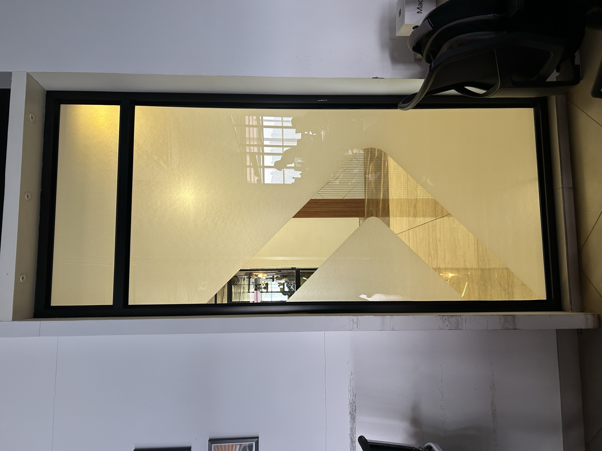

# Suggestion 26: for same a suggehtion like transperant but bit cahnge

- **Status:** done
- **Section:** Door · Workspace
- **Point:** x 9.80, y 1.33, z 15.58 m (x from the window wall, z from the corner-cabin end; see floorplan/floorplan_proposed.png)
- **Created:** 2026-11-20 06:52 · **Updated:** 2026-11-20 06:52

## What needs to change

for same a suggehtion like transperant but bit cahnge

## Attachments

- 
- 

## Claude's notes

Same for the second door at z 15.45, with the IMG_5732 pattern: frosted top, a clear diagonal ribbon, frosted arrow on the left and frosted bottom right. The pixbit sign in the hall moved between the two doors.
