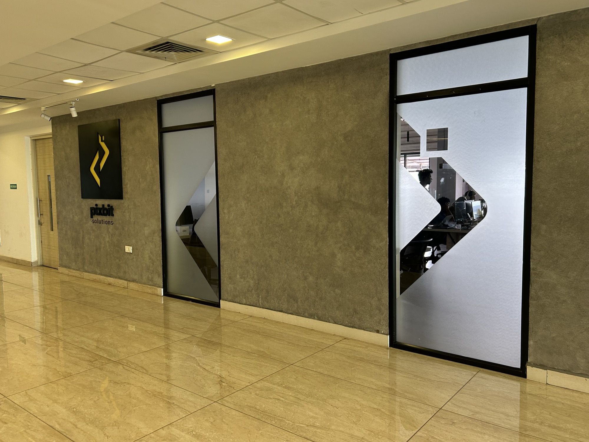

# Suggestion 27: make it look like this

- **Status:** done
- **Section:** Building Hall
- **Point:** x 10.33, y 1.41, z 13.78 m (x from the window wall, z from the corner-cabin end; see floorplan/floorplan_proposed.png)
- **Created:** 2026-11-20 06:55 · **Updated:** 2026-11-20 06:55

## What needs to change

make it look like this

## Attachments

- 
- 

## Claude's notes

Pixbit wall in the hall now follows IMG_5708: both see-through glass doors are 1 m wide and almost reach the bulkhead (door + transom, black frames set straight into the concrete), with concrete between them. The workspace side bays were widened to match.
