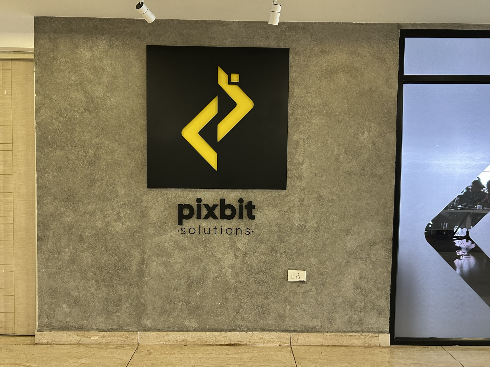

# Suggestion 28: logo is in here

- **Status:** done
- **Section:** Building Hall
- **Point:** x 10.30, y 1.47, z 16.77 m (x from the window wall, z from the corner-cabin end; see floorplan/floorplan_proposed.png)
- **Created:** 2026-11-20 06:57 · **Updated:** 2026-11-20 06:57

## What needs to change

logo is in here

## Attachments

- 
- 

## Claude's notes

The pixbit logo is now here (IMG_5710): a black square panel with the yellow mark, "pixbit · solutions ·" letters directly on the concrete below it, a socket, and two white track spotlights above. The small sign that was between the doors is gone.
