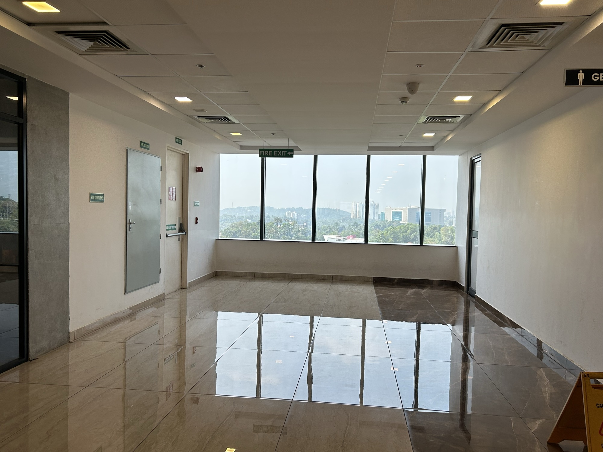

# Suggestion 29: make the right side space i thing a bit more , like match the image

- **Status:** done
- **Section:** Building Hall
- **Point:** x 13.24, y 0.60, z -2.00 m (x from the window wall, z from the corner-cabin end; see floorplan/floorplan_proposed.png)
- **Created:** 2026-11-20 06:58 · **Updated:** 2026-11-20 06:58

## What needs to change

make the right side space i thing a bit more , like match the image

## Attachments

- 
- 

## Claude's notes

The north end is wider on the right (IMG_5705): the hall opens 1.4 m further east for the last 2.8 m, the glass door sits in that bay next to the window, the window is in the middle of the end wall with solid wall each side, and the brown marble continues into the bay.
