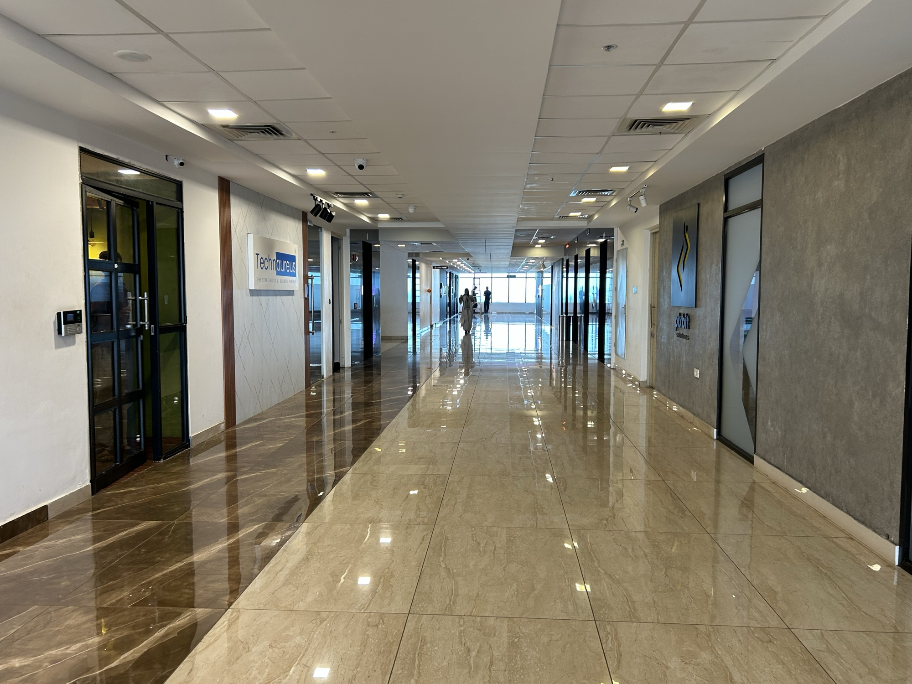

# Suggestion 30: use this

- **Status:** done
- **Section:** Building Hall
- **Point:** x 12.92, y 1.27, z 30.12 m (x from the window wall, z from the corner-cabin end; see floorplan/floorplan_proposed.png)
- **Created:** 2026-11-20 06:59 · **Updated:** 2026-11-20 06:59

## What needs to change

use this

## Attachments

- 
- 

## Claude's notes

The hall now runs on to z 42 like IMG_5707: past the office it has a laminate door, then black-framed dark glass office fronts on both sides with white pillars, glass doors and desks visible inside, and the window at the far end.
