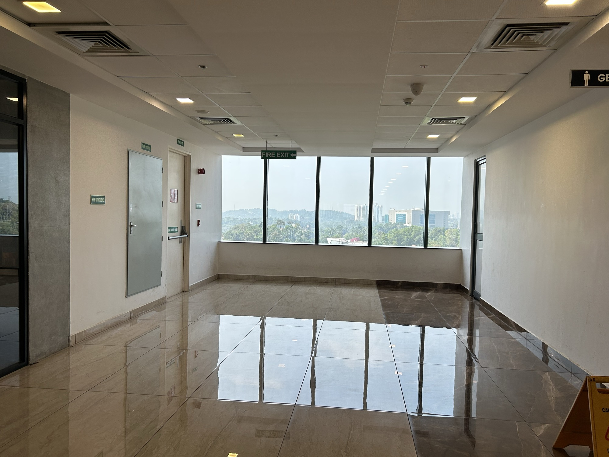

# Suggestion 33: can u make the right wall full wall and every thing a little bit close , like th

- **Status:** done
- **Section:** Building Hall
- **Point:** x 14.52, y 1.55, z -2.12 m (x from the window wall, z from the corner-cabin end; see floorplan/floorplan_proposed.png)
- **Created:** 2026-11-20 07:11 · **Updated:** 2026-11-20 07:11

## What needs to change

can u make the right wall full wall and every thing a little bit close , like this hallwidt a bit close , compare with this image

## Attachments

- 
- 

## Claude's notes

Hall narrowed to 5.8 m (was 7.3 m); north window widened with a solid east corner, like the photo.
