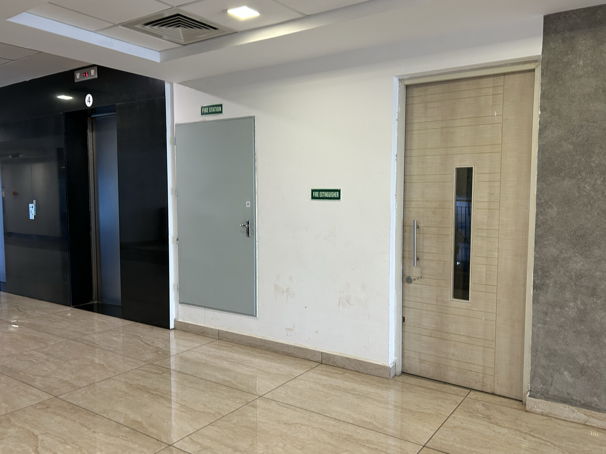

# Suggestion 35: make this look like this

- **Status:** done
- **Section:** Building Hall
- **Point:** x 10.33, y 1.34, z 21.95 m (x from the window wall, z from the corner-cabin end; see floorplan/floorplan_proposed.png)
- **Created:** 2026-11-20 07:13 · **Updated:** 2026-11-20 07:13

## What needs to change

make this look like this

## Attachments

- 
- 

## Claude's notes

The west wall south of the glass entrance is now the lift lobby from your photo: grey fire station hatch with its green sign, fire extinguisher sign, and the black granite lift wall starting after it.
