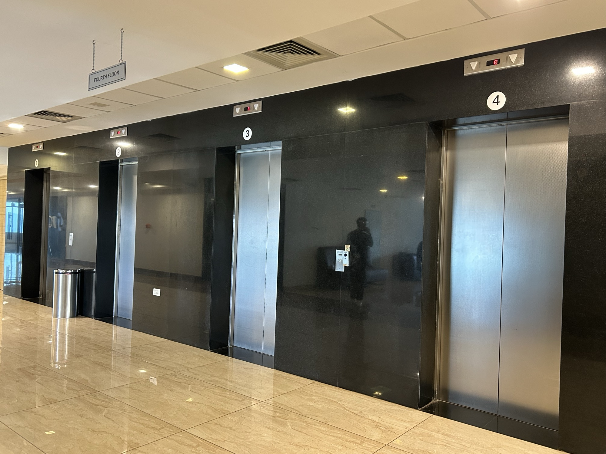

# Suggestion 36: for more detial prev suggestion

- **Status:** done
- **Section:** Building Hall
- **Point:** x 10.33, y 1.45, z 23.38 m (x from the window wall, z from the corner-cabin end; see floorplan/floorplan_proposed.png)
- **Created:** 2026-11-20 07:13 · **Updated:** 2026-11-20 07:13

## What needs to change

for more detial prev suggestion

## Attachments

- 
- 

## Claude's notes

Added the four lifts (numbered 4 to 1 from the wood door southwards) in black granite with steel doors and frames, white number discs, arrow/red indicators, a card reader, socket, two steel bins and the hanging FOURTH FLOOR sign. The glass offices now start after the lifts.
