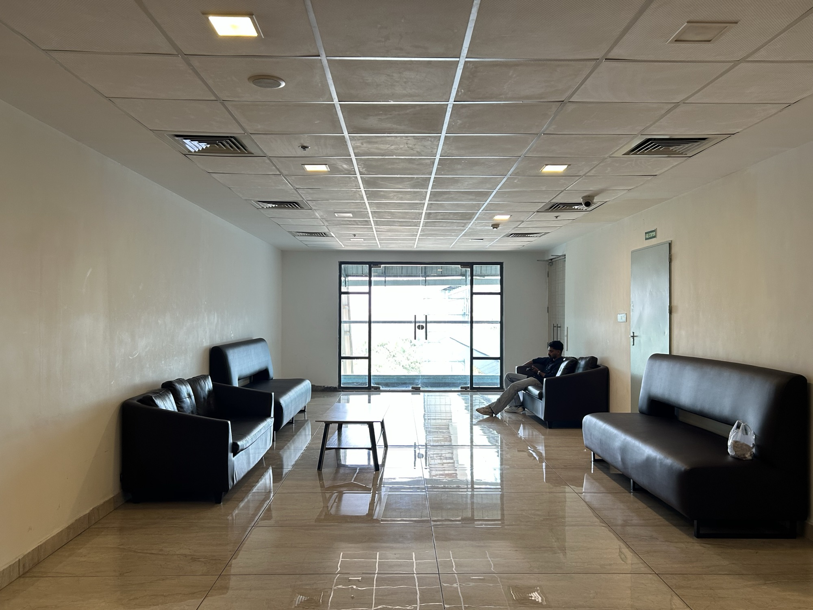

# Suggestion 38: add this , using i added image , this added here for , whare u know this view fr

- **Status:** done
- **Section:** Building Hall
- **Point:** x 16.07, y 1.60, z 29.48 m (x from the window wall, z from the corner-cabin end; see floorplan/floorplan_proposed.png)
- **Created:** 2026-11-20 08:39 · **Updated:** 2026-11-20 08:39

## What needs to change

add this , using i added image , this added here for , whare u know this view from

## Attachments

- 
- 

## Claude's notes

Added a sofa lounge off the east side at z 27–32, built from your photos: beige floor, white walls, grid ceiling with downlights, black leather sofas along both walls, a wooden coffee table, a fire station hatch and a bright glass door at the far end.
