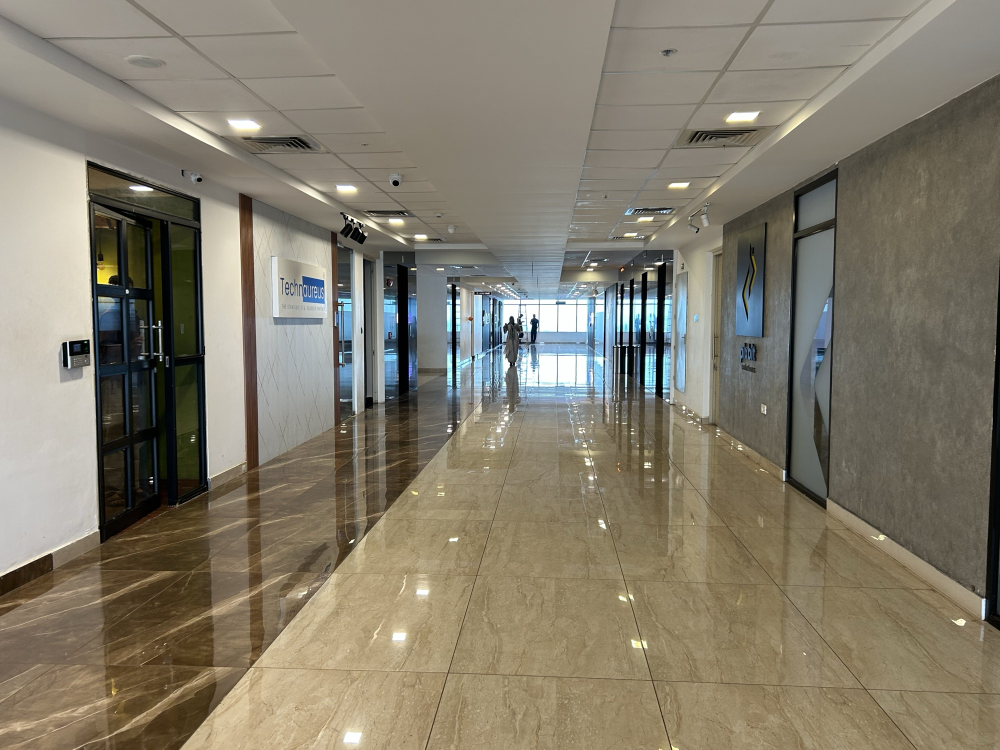
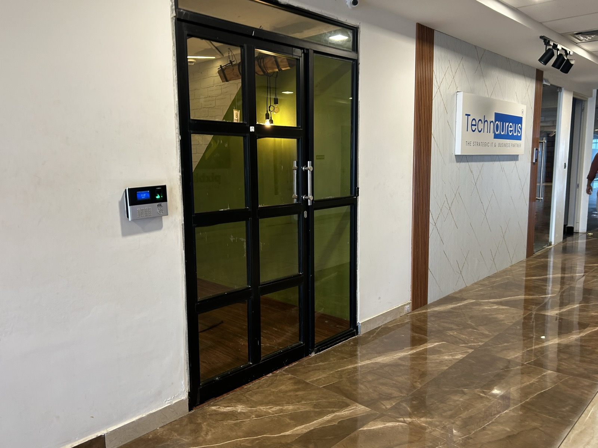

# Suggestion 39: match the left wall using this image

- **Status:** done
- **Section:** Building Hall
- **Point:** x 16.07, y 1.54, z 16.84 m (x from the window wall, z from the corner-cabin end; see floorplan/floorplan_proposed.png)
- **Created:** 2026-11-20 08:46 · **Updated:** 2026-11-20 08:46

## What needs to change

match the left wall using this image

## Attachments

- 
- 
- 

## Claude's notes

Moved the neighbour office so it starts opposite the pixbit sign (from your close-up IMG_5709): white wall with a fingerprint terminal, a black 8-pane double door with a 2-pane side light and transom, and a green room with pendant bulbs behind it. After that comes white wall, a wood slat strip, the diamond panel with the Technaureus sign and spots, another wood strip, then the glass offices. The wall opposite the office doors is now plain white.
