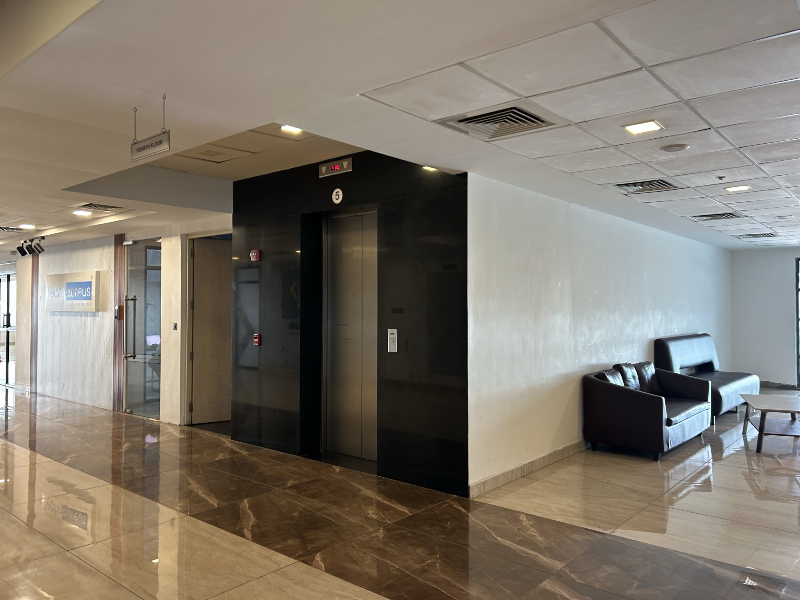
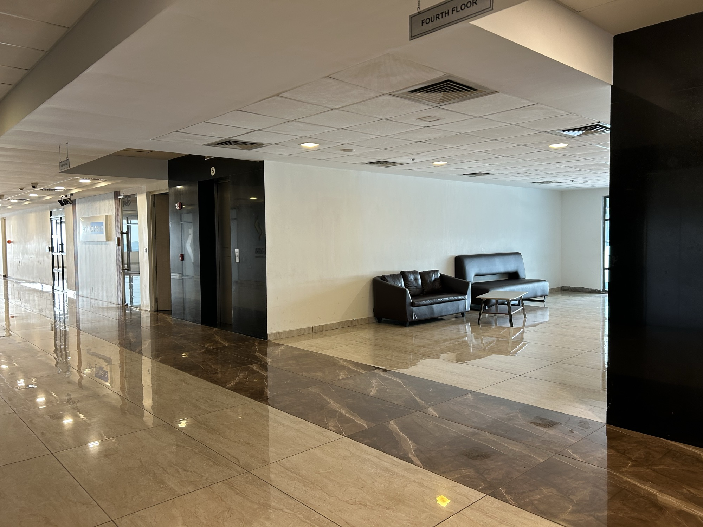

# Suggestion 40: using this image improve this area and the right side space length and widht

- **Status:** done
- **Section:** Building Hall
- **Point:** x 17.16, y 0.93, z 27.40 m (x from the window wall, z from the corner-cabin end; see floorplan/floorplan_proposed.png)
- **Created:** 2026-11-20 08:54 · **Updated:** 2026-11-20 08:54

## What needs to change

using this image improve this area and the right side space length and widht

## Attachments

- 
- 
- 
- 

## Claude's notes

Made the lounge behind lift 5 much bigger, like IMG_5743/5745: the opening now runs from the lift block to a black granite pillar (about 6.4 m wide) and the room goes 11 m back. It has long white walls, a grid ceiling with downlights and AC vents, tufted club sofas and modern bench sofas on both walls, a white-top coffee table, the fire station door, and a black-framed glass screen with a double door at the far end.
