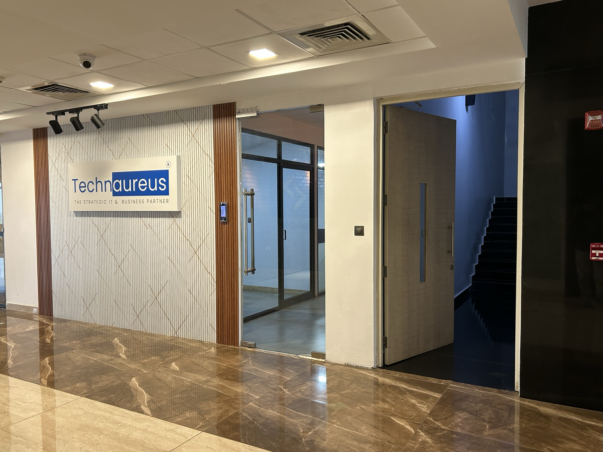
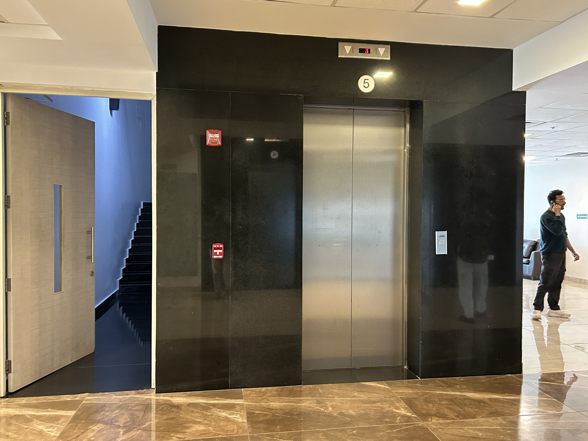

# Suggestion 41: from the logo fixed adjest other thing from this image , like add this lift and

- **Status:** done
- **Section:** Building Hall
- **Point:** x 16.07, y 1.42, z 24.11 m (x from the window wall, z from the corner-cabin end; see floorplan/floorplan_proposed.png)
- **Created:** 2026-11-20 08:58 · **Updated:** 2026-11-20 08:58

## What needs to change

from the logo fixed adjest other thing from this image , like add this lift and

## Attachments

- 
- 
- 
- 

## Claude's notes

Kept the Technaureus sign where it was and added the rest from IMG_5713/5714: a face reader on the wood strip, a frameless glass door into a grey-floored room, a white pier with a switch, the laminate stair door standing open onto a blue stairwell with black steps, then lift 5 in black granite (steel doors, number 5 disc, red floor display, call button, fire alarm and pull station) with a FOURTH FLOOR sign hanging in front.
