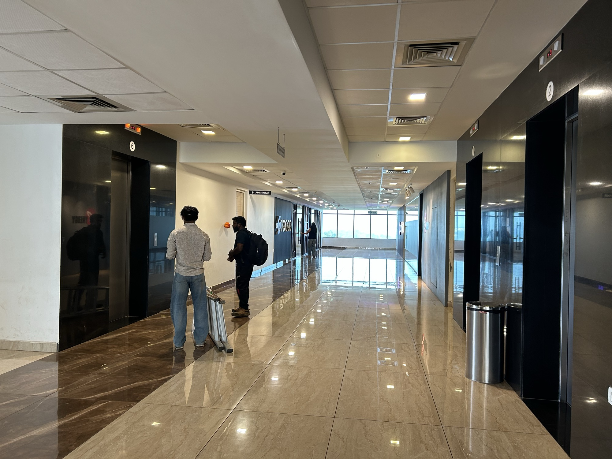

# Suggestion 45: fix this side using this image

- **Status:** done
- **Section:** Building Hall
- **Point:** x 15.24, y 1.20, z 42.12 m (x from the window wall, z from the corner-cabin end; see floorplan/floorplan_proposed.png)
- **Created:** 2026-11-20 09:14 · **Updated:** 2026-11-20 09:14

## What needs to change

fix this side using this image

## Attachments

- 
- 

## Claude's notes

Rebuilt the south end from IMG_5736. On the east side (left in your photo, past the lounge): a white pier, lift 6 in black granite (same front as the other lifts), then a white wall with the LADIES TOILET laminate door, blade sign and fire ball, then a navy slatted panel and glass offices. On the west side (right in your photo, past lift 1): a grey wall with a flush door and track spots, a glass office with a frosted band, a navy panel, and more glass. The hall is now 5 m longer (window at z 47) so all of this fits.
