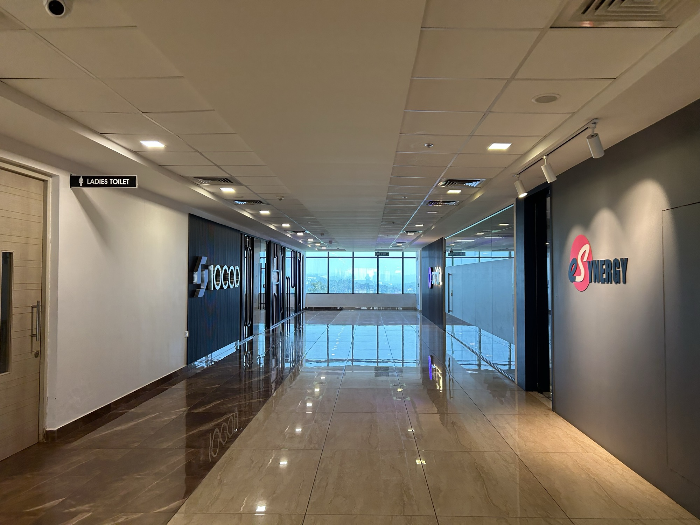

# Suggestion 46: add this with the prev one

- **Status:** done
- **Section:** Building Hall
- **Point:** x 13.56, y 1.53, z 42.12 m (x from the window wall, z from the corner-cabin end; see floorplan/floorplan_proposed.png)
- **Created:** 2026-11-20 09:16 · **Updated:** 2026-11-20 09:16

## What needs to change

add this with the prev one

## Attachments

- 
- 

## Claude's notes

Added with suggestion 45 from IMG_5738: the ladies toilet door + sign, the navy slatted panel (10COD logo), the grey eSynergy wall with track spots, the frosted-band glass office and the green FIRE EXIT sign over the end window. Like the Technaureus sign, the neighbour logos (10COD, eSynergy, ring logo) only show in dev mode (P).
